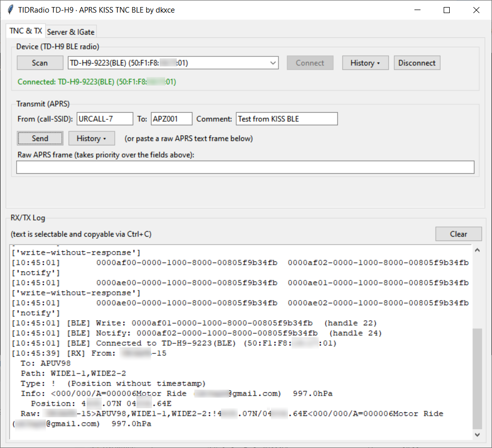
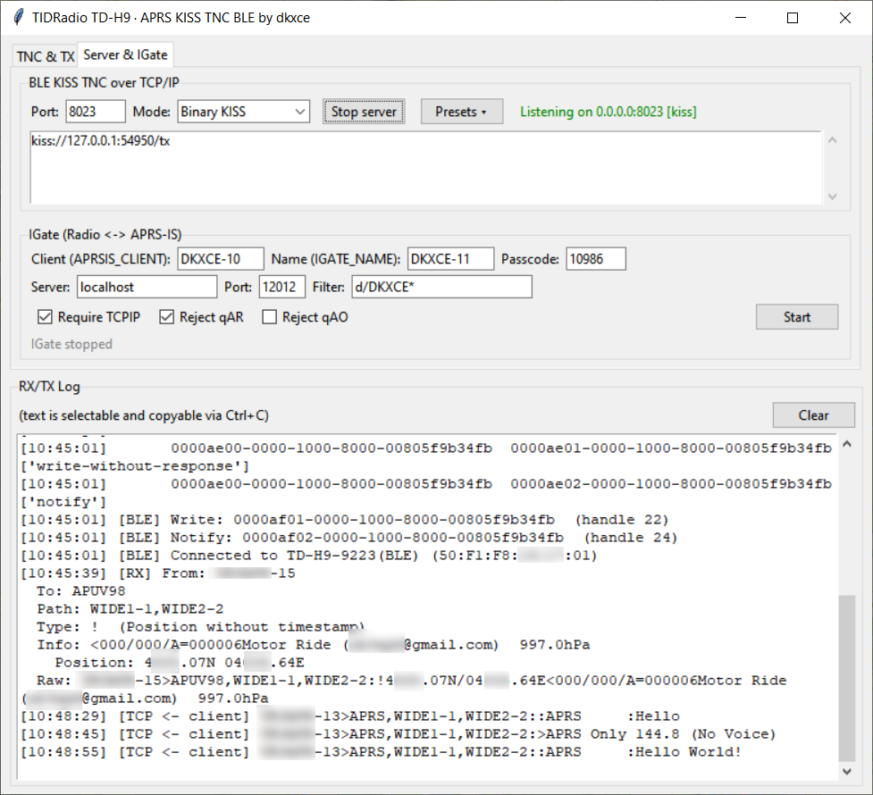

# TIDRadio TD-H9 - APRS KISS TNC BLE

[RU](README.md) | [EN](README.en.md) | [Releases](https://github.com/dkxce/tdh9desktop/releases)

Program turns radio**TIDRadio TD-H9**(and compatible firmware with BLE-service)
Odmaster**KISS-TNC Modem Over Bluetooth Low Energy**. The radio acts as
hardware TNC: it modulates / demodulates the AFSK signal 1200 baud, and the program
It exchanges ready-made KISS/AX.25 frames over BLE. On top of that, the program.
Elevates TCP servers for external APRS applications and built-in IGate.

---

## 1. What is it and why?

TIDRadio TD-H9 radios do not emit sound (AFSK) outwards like conventional TNC radios.
Instead, it's built-in.**TNC**who communicates with the outside
Bluetooth device. This allows the PC to go to APRS air without
audio cables and a separate TNC device.

The task of the program is to make such a radio a full-fledged TNC modem with which
may work**any**APRS applications (maps, UI clients, digitizers/igate).

```
текстовый APRS-кадр (SRC>DST,PATH:info)
      │  encode_ax25
      ▼
бинарный AX.25-кадр (адреса по 7 байт, control, PID, info)
      │  kiss_escape + FEND
      ▼
KISS-фрейм: [0xC0][port:cmd][escape(AX.25)][0xC0]
      │  BLE GATT write / notify
      ▼
рация TIDRadio (AFSK 1200 бод в эфир и обратно)
```

---

## 2. Opportunities

* **BLE radio connection**KISS-TNC (Scanning, Device History)
  Auto-connection via MAC from memory.
* Exchange**KISS protocol**(borders)`0xC0`escape`0xDB`/`0xDC`/`0xDD`).
* **Binary AX. 25.**ный text APRS: reception and transmission, careful analysis without
  "Cracofish."
* **Three TCP servers**At the same time, they are selected by the regime:
* **Binary Kiss**(Port 8023) – raw KISS stream for TNC clients
* **AGWP**(port 8000) – 36-byte headers, Dire Wolf format;
* **APRS-IS**Port 14580 is a text protocol with passcode verification.
* **Built-in IGate**Radio щий APRS-IS (incoming and outgoing gates)
  Filtering rules, autosave settings).
* **Sending APRS**from GUI: From/To/Comment fields or raw frame, history (MRU).
* **Log RX/TX**with highlighting and copying, vertical scrolling.
* **List of connected customers**Scrolling TCP servers.
* **Logs of received/sent packages**JSON.`packet_log`), device history
  and messages`mru_store`).

---

## 3. Requirements

* Python**3. 10 +**(GUI on tkinter) or 3.11+.
* Library**bleak**for BLE`pip install bleak`).
* Radio TIDRadio TD-H9 (or firmware with APRS service)**0000af**).
* Windows / macOS / Linux (tested on Windows)

---

## 4. Quick start.

```
pip install bleak
python main.py
```

1. Launch it.`python main.py`.
2. In the tab**"TNC & TX"**press**Scan**- Select the radio from the list,
   press**Connect Connect Connect**.
3. Connect and make sure there are services (Write/Notify) in the log.
4. In the tab**"Server & IGate"**Select the server mode and port, press**Start server**.
5. Connect an external APRS application (see Compatibility section).
6. To transfer the packet, fill in the Transmit fields and press**Send.**or
   Send it through a connected application.

---

## 5. Structure of the project

| File. | Role |
| --- | --- |
| `main.py` | GUI (Tk), orchestration, two tabs, RX/TX log |
| `ble_radio.py` | BLE transport (bleak, asyncio in the stream), performance resolution |
| `gatt_info.py` | Description of services/characteristics of BLE GATT |
| `kiss.py` | KISS protocol (packaging/unpacking) |
| `ax25.py` | Binary AX.25 readable APRS text |
| `aprs_parser.py` | Analysis of APRS packet content (position, message, etc.) |
| `kiss_tcp_server.py` | TCP server Binary KISS (8023) |
| `agw_server.py` | TCP server AGWPE / Dire Wolf (8000) |
| `aprsis_server.py` | APRS-IS TCP server (14580) |
| `igate.py` | built-in IGate (radio о APRS-IS), settings |
| `mru_store.py` | device history |
| `packet_log.py` | logs of received/sent packages |
| `aprsis_test.py`, `igate_test.py` | Test clients (listener/igate sender) |
| `settings.json` | IGate settings (in the module folder) |

---

## 6. BLE (Services and Specifications)

The program uses the APRS service from the Odmaster application:

| Appointment | UUID |
| --- | --- |
| APRS service | `0000af00-0000-1000-8000-00805f9b34fb` |
| TX (write) | `0000af01-0000-1000-8000-00805f9b34fb`(write-without-response) |
| RX (notify) | `0000af02-0000-1000-8000-00805f9b34fb` |

There are reserve candidates for other firmwares.`ff02`/`ffe2`for the record,`ff01`/`ffe1`for notify. The resolution of characteristics occurs automatically when
connection; the found set is stored in`devcfg_<address>.json`speed
reconnection.

---

## 7. TCP servers

We can launch it.**single**server at the same time. The mode is selected in the GUI and through
presets:

| Regime. | Default port | Protocol | How useful |
| --- | --- | --- | --- |
| `Binary KISS` | 8023 | raw KISS frames | hardware/software TNC clients |
| `AGW (AGWPE)` | 8000 | 36-byte AGW headers, Dire Wolf format | UISS, UI-View32, AGW clients |
| `APRS-IS` | 14580 | APRS + login/passcode | network APRS-clients and tests |

Incoming radio packets are sent to all connected customers in their
format (KISS bytes / AGW monitor / APRS-IS strings). Outgoing client staff
They are encoded in AX.25 and sent to the BLE radio.

### Binary KISS (kiss tcp server.py)

The client sends and receives raw KISS frames just like a serial TNC over the network.
No login. All customers can transfer.

### AGWPE (agw server.py)

Compatible with AGWPE TCP/IP protocol and format**Dire Wolf.**(36-byte)
headline. Supports typical AGW requests:
-`R`- version (AGWPE 2005/127);
-`G`/`g`information about the port and its capabilities;
-`X`- registration of the call sign;
-`m`/`k`- inclusion of monitoring / raw personnel;
-`V`/`M`- transmission of UI-frame (with / without diga);`K`- raw AX.25.

Reception: sends out monitor footage`U`Dire Wolf format
?`" 1:Fm SRC To DST Via ... <UI pid=.. Len=.. >[HH:MM:SS]"`). It's tested with
UISS clients and AGW clients.

### APRS-IS (aprsis server.py)

The APRS-IS text protocol. Client logs in line`user CALLSIGN pass PASSCODE vers ... filter ...`. **Passcode is mandatory**and
is verified by the standard APRS-IS algorithm; an incorrect passcode gives only
Reading the ether (unverified). Comments`#`They're not on the radio.

---

## 8. Built-in IGate

`igate.py`An independent bridge between APRS radio and APRS-IS:

* **Network → radio:**The package is broadcast only if it is in its path.`<IGATE_NAME>`It passes the flag (Reject qAR/qAO, Require TCPIP).
* **Radio → Network:**add`,qAR,<IGATE_NAME>`and the package goes
  APRS-IS.
* Customer login:`user <APRSIS_CLIENT> pass <PASSCODE> vers TDH9KissIGate v1.0 filter <FILTER>`.
  defaulter`d/<IGATE_NAME>*`(to the addressee, without SSID).
* Flags apply**fly**(no restart) thanks to live-getter.
* The settings are stored in`settings.json`beside the module and remain in
  push**Start.**And when the window closes.
* In GUI, one button**Start/stop**.

---

## 9. Compatibility with APRS applications

The program transmits the radio through**three**interface, so it works with it.
A wide range of desktop APRS applications.

### UISS

* Connected to the program as with**AGW engine (AGWPE TCP/IP)**.
* In UISS, select TNC/communication:**AGW Packet Engine, TCP/IP**State the port.**8000**(server mode)`AGW (AGWPE)`).
* UISS uses AGW version requests, port and monitoring; transmission is supported
  and receiving packets, positions and messages.

### UI-View32

* Connection through**AGWPE TCP/IP**(port 8000).
* In the UI-View32 settings, specify the interface**AGWP** / **AGW TCP/IP**host`127.0.0.1`(or where the program is running), port`8000`.
* Receive all ether through the AGW-monitor and transmission through digpiters.

### APRSIS32

* Connected to**TCP/IP**either way**AGW**(port 8000), or (in some
  assemblies) as KISS-TNC.
* Specify the connection type**AGW**and server address; APRSIS32 will send AGW frames
  and take monitoring.
* It can also work through**Binary Kiss**(port 8023) as via conventional TCP-TNC.

### KMZViewer (https://github.com/dkxce/KMZViewer)

* Map Viewer App/KMZ of the author of the project; receives APRS stream
  The interface the program provides (KISS/AGW/APRS-IS).
* Configure the APRS source in KMZViewer to the local program server
  (e.g. APRS-IS)`127.0.0.1:14580`or KISS.

### APRSWin (https://github.com/dkxce/APRSWin)

* Windows-APRS client; connects to the program as a TNC**TCP**mode**Binary Kiss**(port 8023) or**AGW**(port 8000).
* Uses reading the entire ether through the KISS/AGW monitor and transmission from the map.

### APRSAir (https://github.com/dkxce/APRSAIR)

* APRS-client/author program; also works through local KISS/AGW/APRS-IS
  program interface.

### SimpleAPRSServer (https://github.com/dkxce/SimpleAPRSServer)

* Simple APRS server that allows you to exchange data between all
  connected customers. Allows you to cache and store the last
  received coordinates and issue them when connecting.

> **In short:**All of these programs are connected externally via TCP.
> If they can.**AGWP**- Use the mode.`AGW (AGWPE)`(port 8000);
> wait**KISS-TNC on TCP**regime`Binary KISS`(port 8023);
> a any APRS-IS-compatible mode`APRS-IS`(port 14580).

---

## 10. Data flow principle

```
        рация TIDRadio TD-H9 (TNC + AFSK 1200)
                    ▼  BLE GATT 0000af00 (write af01 / notify af02)
        ble_radio.py (bleak, asyncio)
                    ▼  KISS-фреймы
        kiss.py  ⇄  ax25.py  ⇄  aprs_parser.py
                    ▼
        main.py
     ┌──────────┼──────────┬──────────┐
 KISS(8023)  AGW(8000)  APRS-IS(14580)  IGate(радио APRS-IS)
     └──────────┼──────────┴──────────┘
        внешние APRS-клиенты / APRS-IS сеть
```

---

## 11. KISS and AX.25 format (short reference)

* **KISS:** `FEND=0xC0`, `FESC=0xDB`, `TFEND=0xDC`, `TFESC=0xDD`command
  bytes`0x01 TXDELAY`, `0x02 PERSIST`, `0x03 SLOTTIME`, `0x04 TXTAIL`,
  `0x05 FULLDUPLEX`, `0x06 SETHARDWARE`, `0xFF RETURN`.
* **AX.25 UI:**control`0x03`PID`0xF0`Addresses - 7 bytes (6 characters)
  shifted to the left + SSID / flag), the call sign in the upper / Latin register.
* The program itself encodes the text in binary AX.25 and back, so clients can use it.
  There's a lot of APRS text.

---

## 12. License and authorship

Programme -**author's project dkxce**https://github.com/dkxce.  
Written for compatibility with TIDRadio TD-H9.

---

## 13. Screenshots

   


---

**Author**: [dkxcece](https://github.com/dkxce)   
**Android**: [dkxce/tdh9android](https://github.com/dkxce/tdh9android)   
**Desktop**: [dkxce/tdh9desktop](https://github.com/dkxce/tdh9desktop)   
**Manual**: [dkxce/Tidradio-TD-H9](https://github.com/dkxce/Tidradio-TD-H9)