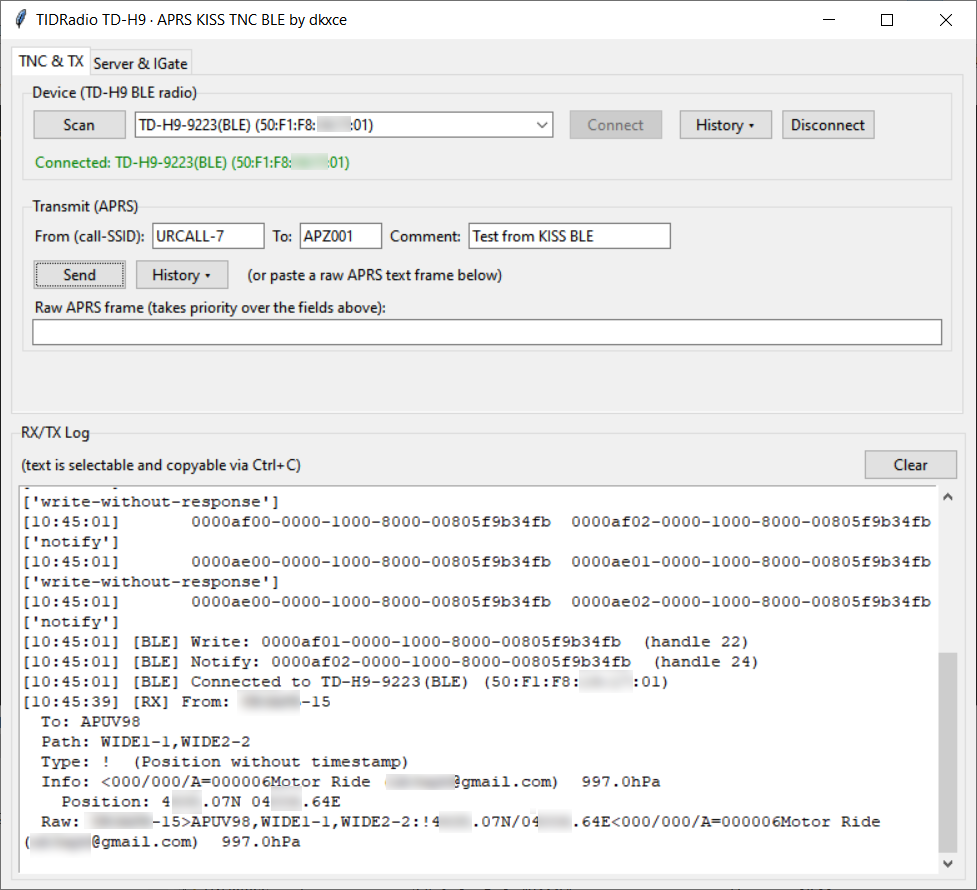
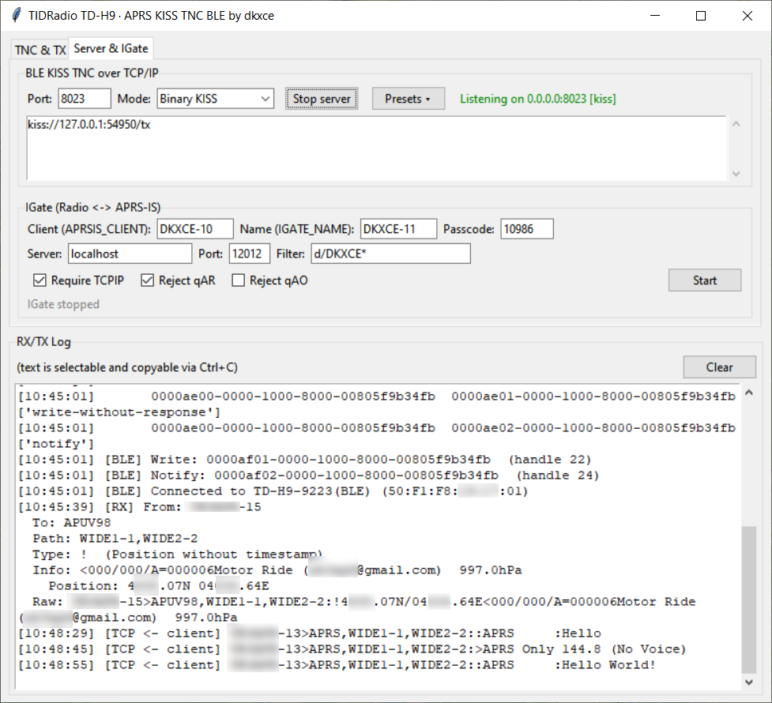

# TIDRadio TD-H9 · APRS KISS TNC BLE

[RU](README.md) | [EN](README.en.md) | [Releases](https://github.com/dkxce/tdh9desktop/releases)

Программа превращает рацию **TIDRadio TD-H9** (и совместимые прошивки с BLE-сервисом
Odmaster) в **KISS-TNC-модем над Bluetooth Low Energy**. Рация выступает как
аппаратный TNC: она сама модулирует/демодулирует AFSK-сигнал 1200 бод, а программа
обменивается с ней готовыми KISS/AX.25-кадрами по BLE. Поверх этого программа
поднимает TCP-серверы для внешних APRS-приложений и встроенный IGate.

---

## 1. Что это и зачем

Рации серии TIDRadio TD-H9 не отдают звук (AFSK) наружу, как обычные TNC-радио.
Вместо этого внутри работает встроенный **TNC**, который общается с внешним
устройством по Bluetooth. Это позволяет ПК выходить в APRS-эфир без
аудио-кабелей и отдельного TNC-аппарата.

Задача программы — сделать из такого радио полноценный TNC-модем, с которым
могут работать **любые** APRS-приложения (карты, UI-клиенты, дигпитеры/igate).

```
текстовый APRS-кадр (SRC>DST,PATH:info)
      │  encode_ax25
      ▼
бинарный AX.25-кадр (адреса по 7 байт, control, PID, info)
      │  kiss_escape + FEND
      ▼
KISS-фрейм: [0xC0][port:cmd][escape(AX.25)][0xC0]
      │  BLE GATT write / notify
      ▼
рация TIDRadio (AFSK 1200 бод в эфир и обратно)
```

---

## 2. Возможности

- **BLE-подключение к рации** как к KISS-TNC (сканирование, история устройств,
  автоподключение по MAC из памяти).
- Обмен по **KISS-протоколу** (границы `0xC0`, escape `0xDB`/`0xDC`/`0xDD`).
- **Бинарный AX.25** ⇄ текстовый APRS: приём и передача, аккуратный разбор без
  «кракозябр».
- **Три TCP-сервера** одновременно, выбираются режимом:
  - **Binary KISS** (порт 8023) — сырой KISS-поток для TNC-клиентов;
  - **AGWPE** (порт 8000) — 36-байтные заголовки, формат Dire Wolf;
  - **APRS-IS** (порт 14580) — текстовый протокол с проверкой passcode.
- **Встроенный IGate** — радио ⇄ APRS-IS (входящий и исходящий гейтинг,
  правила фильтрации, автосохранение настроек).
- **Отправка APRS** из GUI: поля From/To/Comment или сырой кадр, история (MRU).
- **Лог RX/TX** с выделением и копированием, вертикальной прокруткой.
- **Список подключённых клиентов** TCP-серверов с прокруткой.
- **Журналы принятых/отправленных пакетов** в JSON (`packet_log`), история устройств
  и сообщений (`mru_store`).

---

## 3. Требования

- Python **3.10+** (GUI на tkinter) или 3.11+.
- Библиотека **bleak** для BLE (`pip install bleak`).
- Рация TIDRadio TD-H9 (или прошивка с сервисом APRS **0000af00**).
- Windows / macOS / Linux (проверено на Windows).

---

## 4. Быстрый старт

```bash
pip install bleak
python main.py
```

1. Запустите `python main.py`.
2. Во вкладке **«TNC & TX»** нажмите **Scan** — выберите рацию из списка,
   нажмите **Connect**.
3. Подключитесь и убедитесь, что в логе появились сервисы (Write/Notify).
4. Во вкладке **«Server & IGate»** выберите режим сервера и порт, нажмите
   **Start server**.
5. Подключите внешнее APRS-приложение (см. раздел «Совместимость»).
6. Чтобы передать пакет — заполните поля Transmit и нажмите **Send**, либо
   передавайте через подключённое приложение.

---

## 5. Структура проекта

| Файл | Роль |
|---|---|
| `main.py` | GUI (Tk), оркестрация, две вкладки, лог RX/TX |
| `ble_radio.py` | BLE-транспорт (bleak, asyncio в потоке), разрешение характеристик |
| `gatt_info.py` | описание сервисов/характеристик BLE GATT |
| `kiss.py` | KISS-протокол (упаковка/распаковка кадров) |
| `ax25.py` | бинарный AX.25 ⇄ читаемый APRS-текст |
| `aprs_parser.py` | разбор содержимого APRS-пакета (позиция, сообщение и т.д.) |
| `kiss_tcp_server.py` | TCP-сервер Binary KISS (8023) |
| `agw_server.py` | TCP-сервер AGWPE / Dire Wolf (8000) |
| `aprsis_server.py` | TCP-сервер APRS-IS (14580) |
| `igate.py` | встроенный IGate (радио ⇄ APRS-IS), настройки |
| `mru_store.py` | история устройств и сообщений |
| `packet_log.py` | журналы принятых/отправленных пакетов |
| `aprsis_test.py`, `igate_test.py` | тестовые клиенты (listener / IGate sender) |
| `settings.json` | настройки IGate (в папке модуля) |

---

## 6. BLE (сервисы и характеристики)

Рация TD-H9 / Odmaster выставляет несколько Bluetooth-сервисов. Программа
использует **APRS-сервис** для KISS-TNC (`af00`) и **сервис клонирования** (`ff00`)
для чтения настроек APRS/GNSS (вкладка «Settings (APRS)»).

### 6.1 APRS / KISS TNC сервис (основной)

| Назначение | UUID | Роль в программе |
|---|---|---|
| APRS service | `0000af00-0000-1000-8000-00805f9b34fb` | сервис TNC |
| TX (write) | `0000af01-0000-1000-8000-00805f9b34fb` | отправка KISS-фрейма в рацию (write-without-response) |
| RX (notify) | `0000af02-0000-1000-8000-00805f9b34fb` | приём KISS-фреймов из рации |

Через этот сервис идёт весь обмен APRS: программа пишет KISS-фреймы
(`[0xC0][port:cmd][escape(AX.25)][0xC0]`) в `af01` и слушает `af02`.

### 6.2 Сервис клонирования / компонент настроек (FF00)

Используется для **скачивания (чтения) полного образа настроек рации** — во вкладке
«Settings (APRS)» (read-only). Протокол h9toolbox/Odmaster:

| Назначение | UUID |
|---|---|
| Clone service | `0000ff00-0000-1000-8000-00805f9b34fb` |
| Write (команды) | `0000ff02-0000-1000-8000-00805f9b34fb` |
| Notify (ответы) | `0000ff01-0000-1000-8000-00805f9b34fb` |
| Notify (DX, расшир.) | `0000ff21-0000-1000-8000-00805f9b34fb` |
| Write (DX, расшир.) | `0000ff22-0000-1000-8000-00805f9b34fb` |

**Протокол чтения образа (только чтение):**
1. Рукопожатие: отправить `50 56 4F 4A 48 5C 14` → ждать ACK `06`.
2. Идентификация: послать `02` → прочитать 8 байт (`TDH9 FF FF FF <mode>`).
3. Вход в режим: послать `06` → ждать ACK `06`.
4. Чтение блоков память `0x3140` байт блоками по `0x20`: на каждый блок команда
   `52 <addrHi> <addrLo> 20`, ответ `57 <addrHi> <addrLo> 20` + 32 байта данных
   + (опц.) 1 байт контрольной суммы.
5. Выход: послать `45`.

Реализация — `ble_radio.py` → `download_settings()`. Обращается к тому же уже
открытому соединению и подписывается на `ff01` только на время чтения.
Распарсенный образ (позывной, пути, beacon, каналы, GNSS) показывается во вкладке
«Settings (APRS)» и копируется в буфер обмена.

**Важно:** во время скачивания по `ff00` рация находится в режиме клонирования —
одновременный приём APRS по `af00` может на короткое время прерываться.

### 6.3 Резервные кандидаты

Для других прошивок/моделей есть резервные UUID записи/notify:
`ff02`/`ffe2` (write), `ff01`/`ffe1` (notify). Разрешение характеристик
происходит автоматически при подключении; найденный набор сохраняется в
`devcfg_<address>.json` для скорости повторного подключения.

### 6.4 Прочие сервисы рации (не используются программой)

| Назначение | UUID |
|---|---|
| Device name | `00001800-0000-1000-8000-00805f9b34fb` / char `00002a00-...` |
| OTA-прошивка (осн.) | сервис `0000ae00-0000-1000-8000-00805f9b34fb` (write `ae01`, notify `ae02`) |
| OTA-прошивка (альт.) | сервис `0000ae30-0000-1000-8000-00805f9b34fb` (write `ae01`, notify `ae02`) |

Это сервисы прошивки и системные; программа их не трогает. Отдельно от BLE,
рация также может работать по **SPP/RFCOMM (классический Bluetooth** `00001101`)
для PTT-микрофона и KISS-TNC в приложении Odmaster — но наш desktop-мост
использует именно BLE-сервис `af00`.

---

## 7. TCP-серверы

Можно запустить **один** сервер одновременно. Режим выбирается в GUI и через
пресеты:

| Режим | Порт по умолчанию | Протокол | Чем полезен |
|---|---|---|---|
| `Binary KISS` | 8023 | сырые KISS-фреймы | аппаратные/программные TNC-клиенты |
| `AGW (AGWPE)` | 8000 | 36-байтные AGW-заголовки, формат Dire Wolf | UISS, UI-View32, AGW-клиенты |
| `APRS-IS` | 14580 | текстовый APRS + логин/passcode | сетевые APRS-клаенты и тесты |

Входящие с радио пакеты рассылаются по всем подключённым клиентам в своём
формате (KISS-байты / AGW-монитор / APRS-IS строки). Исходящие от клиента кадры
кодируются в AX.25 и уходят в рацию по BLE.

### Binary KISS (kiss_tcp_server.py)

Клиент шлёт и получает сырые KISS-кадры точно как последовательный TNC по сети.
Без логина. Все клиенты могут передавать.

### AGWPE (agw_server.py)

Совместим с протоколом AGWPE TCP/IP и форматом **Dire Wolf** (36-байтный
заголовок). Поддерживает типовые запросы AGW:
- `R` — версия (AGWPE 2005/127);
- `G`/`g` — информация о порте и его возможностях;
- `X` — регистрация позывного;
- `m`/`k` — включение мониторинга / сырых кадров;
- `V`/`M` — передача UI-кадра (с диги / без); `K` — сырой AX.25.

Приём: рассылает кадры монитора `U` в формате Dire Wolf
(`" 1:Fm SRC To DST Via ... <UI pid=.. Len=.. >[HH:MM:SS]"`). Это проверено с
клиентами UISS и AGW-клиентами.

### APRS-IS (aprsis_server.py)

Текстовый протокол APRS-IS. Клиент логинится строкой
`user CALLSIGN pass PASSCODE vers ... filter ...`. **Passcode обязателен** и
проверяется по стандартному алгоритму APRS-IS; неверный passcode даёт только
чтение эфира (unverified). Комментарии `#` в радио не передаются.

---

## 8. Встроенный IGate

`igate.py` — самостоятельный мост между радиоэфиром APRS и сетью APRS-IS:

- **Сеть → радио:** пакет гейтится в эфир, только если в его пути есть
  `<IGATE_NAME>` и он проходит флаги (Reject qAR / qAO, Require TCPIP).
- **Радио → сеть:** к пути добавляется `,qAR,<IGATE_NAME>` и пакет уходит в
  APRS-IS.
- Логин клиента:
  `user <APRSIS_CLIENT> pass <PASSCODE> vers TDH9KissIGate v1.0 filter <FILTER>`,
  фильтр по умолчанию `d/<IGATE_NAME>*` (по адресату, без SSID).
- Флаги применяются **на лету** (без перезапуска) благодаря live-getter.
- Настройки хранятся в `settings.json` рядом с модулем и сохраняются при
  нажатии **Start** и при закрытии окна.
- В GUI — одна кнопка **Start/Stop**.

---

## 9. Совместимость с APRS-приложениями

Программа отдаёт радио через **три** интерфейса, поэтому с ней работает
широкий круг настольных APRS-приложений.

### UISS

- Соединяется с программой как с **AGW-движком (AGWPE TCP/IP)**.
- В UISS выберите TNC / связь: **AGW Packet Engine, TCP/IP**, укажите порт **8000**
  (сервер в режиме `AGW (AGWPE)`).
- UISS использует AGW-запросы версии, порта и мониторинг; поддерживается передача
  и приём пакетов, позиций и сообщений.

### UI-View32

- Подключение через **AGWPE TCP/IP** (порт 8000).
- В настройках UI-View32 укажите интерфейс **AGWPE** / **AGW TCP/IP**, хост
  `127.0.0.1` (или где запущена программа), порт `8000`.
- Получите приём всего эфира через AGW-монитор и передачу через дигпитеры.

### APRSIS32

- Подключается по **TCP/IP** либо как **AGW** (порт 8000), либо (в некоторых
  сборках) как KISS-TNC.
- Укажите тип соединения **AGW** и адрес сервера; APRSIS32 будет слать AGW-кадры
  и принимать мониторинг.
- Также может работать через **Binary KISS** (порт 8023) как через обычный TCP-TNC.

### KMZViewer (https://github.com/dkxce/KMZViewer)

- Приложение-просмотрщик карт/KMZ автора проекта; принимает APRS-поток по
  интерфейсу, который программа отдаёт (KISS / AGW / APRS-IS).
- Настройте в KMZViewer источник APRS на локальный сервер программы
  (например, APRS-IS `127.0.0.1:14580` или KISS).

### APRSWin (https://github.com/dkxce/APRSWin)

- Windows-APRS-клиент; подключается к программе как к TNC по **TCP** в режиме
  **Binary KISS** (порт 8023) или **AGW** (порт 8000).
- Использует чтение всего эфира через KISS/AGW-монитор и передачу из карты.

### APRSAir (https://github.com/dkxce/APRSAIR)

- APRS-клиент/программа автора; так же работает через локальный KISS/AGW/APRS-IS
  интерфейс программы.

### SimpleAPRSServer (https://github.com/dkxce/SimpleAPRSServer)

- Простой APRS сервер, который позволяет обмениваться данными между всеми 
  подключенными к нему клиентами. Позволяет кэшировать и хранить последние 
  полученные координаты и выдавать их при входящем подключении.
  
> **Коротко:** все перечисленные программы подключаются снаружи через TCP.
> Если они умеют **AGWPE** — используйте режим `AGW (AGWPE)` (порт 8000);
> если ожидают **KISS-TNC по TCP** — режим `Binary KISS` (порт 8023);
> а любые APRS-IS-совместимые — режим `APRS-IS` (порт 14580).


---

## 10. Принцип потока данных

```
        рация TIDRadio TD-H9 (TNC + AFSK 1200)
                    ▼  BLE GATT 0000af00 (write af01 / notify af02)
        ble_radio.py (bleak, asyncio)
                    ▼  KISS-фреймы
        kiss.py  ⇄  ax25.py  ⇄  aprs_parser.py
                    ▼
        main.py
     ┌──────────┼──────────┬──────────┐
 KISS(8023)  AGW(8000)  APRS-IS(14580)  IGate(радио APRS-IS)
     └──────────┼──────────┴──────────┘
        внешние APRS-клиенты / APRS-IS сеть
```

---

## 11. Формат KISS и AX.25 (краткая справка)

- **KISS:** `FEND=0xC0`, `FESC=0xDB`, `TFEND=0xDC`, `TFESC=0xDD`; командные
  байты `0x01 TXDELAY`, `0x02 PERSIST`, `0x03 SLOTTIME`, `0x04 TXTAIL`,
  `0x05 FULLDUPLEX`, `0x06 SETHARDWARE`, `0xFF RETURN`.
- **AX.25 UI:** control `0x03`, PID `0xF0`; адреса — 7 байт (6 символов
  сдвинутых влево + SSID/флаг), позывной в верхнем/залатинском регистре.
- Программа сама кодирует текст в бинарный AX.25 и обратно, поэтому клиентам
  достаточно текстовых APRS-кадров.

---

## 12. Лицензия и авторство

Программа — **авторский проект dkxce** (с) https://github.com/dkxce.       
Написана для совместимости с TIDRadio TD-H9.

---

## 13. Скриншоты

    
    

---

**Автор**: [dkxce](https://github.com/dkxce)     
**Android**: [dkxce/tdh9android](https://github.com/dkxce/tdh9android)      
**Desktop**: [dkxce/tdh9desktop](https://github.com/dkxce/tdh9desktop)      
**Manual**: [dkxce/Tidradio-TD-H9](https://github.com/dkxce/Tidradio-TD-H9)  